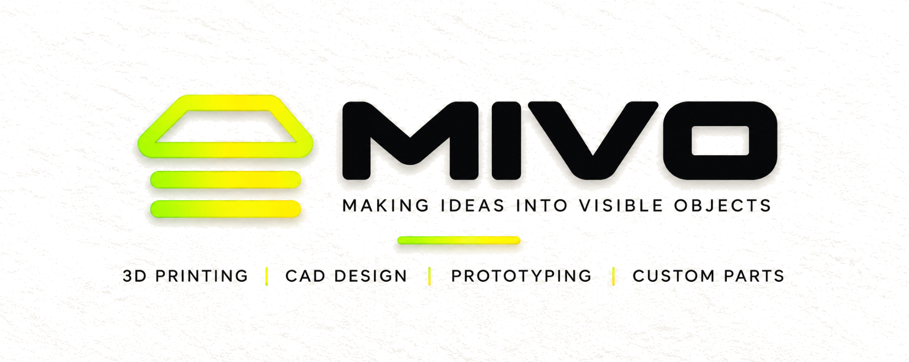

# MIVO - 3D Printing Platform

**Making Ideas into Visible Objects**

A full-stack web application for MIVO 3D Printing services featuring an admin dashboard, STL file viewer, and e-commerce functionality built with Next.js 15, React 19, Three.js, and Supabase.



## 🎨 Brand Identity

- **Brand Name:** MIVO
- **Tagline:** Making Ideas into Visible Objects
- **Location:** Vijayawada, Andhra Pradesh, India

### Brand Colors

- **Ink Black:** `#101010` - Primary text and dark backgrounds
- **Warm Cream:** `#FFF8E8` - Primary background
- **Lime Punch:** `#B7FF2A` - Accent color for CTAs and highlights
- **Citrus Yellow:** `#FFD400` - Secondary accent
- **Electric Orange:** `#FF6A00` - Tertiary accent (used sparingly)

## 🚀 Features

### Public-Facing Website

✅ **Homepage with Premium Design**
- Hero section with MIVO branding
- Scroll-driven cinematic storytelling animation
- Services showcase
- Featured products section
- How it works section
- Custom project CTA
- Brand closing section

✅ **Explore Models Page**
- Browse all published products with real-time database integration
- Search by name, category, or tags
- Filter by category
- Sort by name or price
- Responsive grid layout with product images

✅ **Core UI Components**
- Navigation with mobile menu
- Footer with social links
- Button component (multiple variants)
- Card components
- Input components

✅ **Product Detail Pages**
- Individual product pages with full specifications
- Pricing and material information
- Related products suggestions

✅ **Custom Quote System**
- Custom project request form
- Customer information collection
- Quote submission to database

### Admin Dashboard (Fully Implemented)

✅ **Authentication & Security**
- Secure login with Supabase Auth
- Session-based authentication
- Protected admin routes with middleware
- Row Level Security (RLS) policies

✅ **Product Management**
- Create new products with full details
- Upload STL files (up to 500MB)
- Upload product images
- Real-time 3D preview during creation
- Publish/draft status control
- Edit and delete products
- View all products with stats

✅ **3D Model Viewer & Controls**
- Interactive STL model preview using Three.js
- Auto-scaling to fit any model size
- **Rotation controls**: Full 360° on X, Y, Z axes
- **Position controls**: Adjust X, Y, Z coordinates (-20 to +20)
- **Scale control**: Resize from 0.1x to 5x
- **Color picker**: Preview model in different colors
- Build plate visualization
- Individual and bulk reset controls

✅ **Order Management**
- View all customer orders
- Order status tracking
- Order details and line items

✅ **Quote Management**
- View custom quote requests
- Customer contact information
- Quote status management

✅ **Dashboard Analytics**
- Total products count
- Total orders count
- Pending quotes count
- Quick navigation to all sections

## 🛠️ Tech Stack

- **Framework**: Next.js 15 (App Router)
- **UI Library**: React 19
- **Language**: TypeScript
- **Styling**: Tailwind CSS
- **3D Graphics**: Three.js + React Three Fiber + STLLoader
- **Backend**: Supabase
  - PostgreSQL database
  - Authentication
  - File storage (images & STL files)
  - Row Level Security
- **Animation**: Framer Motion
- **Image Optimization**: Next.js Image with Sharp
- **Package Manager**: npm

## 📁 Project Structure

```
MIVO-website/
├── app/                      # Next.js app directory
│   ├── admin/               # Admin dashboard (protected)
│   │   ├── login/          # Admin login page
│   │   ├── products/       # Product management
│   │   │   └── new/       # Create new product with STL viewer
│   │   ├── orders/         # Order management
│   │   ├── quotes/         # Quote management
│   │   ├── settings/       # Admin settings
│   │   └── test/           # Database connection test page
│   ├── explore/            # Product catalog
│   ├── product/[id]/       # Product detail pages
│   ├── custom/             # Custom quote form
│   ├── about/              # About page
│   ├── contact/            # Contact page
│   ├── cart/               # Shopping cart
│   ├── layout.tsx          # Root layout
│   └── page.tsx            # Homepage
├── components/              # React components
│   ├── admin/              # Admin-specific components
│   │   ├── AdminNav.tsx   # Admin navigation
│   │   └── STLViewer.tsx  # 3D STL model viewer
│   ├── ui/                 # Reusable UI components
│   │   ├── Button.tsx
│   │   ├── Card.tsx
│   │   └── Input.tsx
│   ├── Navigation.tsx      # Main site navigation
│   └── Footer.tsx          # Site footer
├── lib/                     # Utility functions
│   ├── supabase/           # Supabase client setup
│   │   ├── client.ts      # Browser client
│   │   ├── server.ts      # Server client
│   │   └── middleware.ts  # Middleware helpers
│   ├── types/              # TypeScript types
│   └── data/               # Data utilities
├── middleware.ts            # Next.js middleware (auth protection)
├── public/                  # Static assets
│   ├── mivo-logo-*.png     # Logo variations
│   └── services/           # Service images
├── supabase-schema.sql     # Database schema
├── fix-rls-policy.sql      # RLS policy fixes
└── Configuration files
```

## 🎯 Getting Started

### Prerequisites

- Node.js 18+ and npm
- Supabase account (free tier works)
- Python 3 (for logo processing scripts, optional)

### Installation

1. **Clone the repository**
   ```bash
   git clone https://github.com/Saiaditya26122006/MIVO-website.git
   cd MIVO-website
   ```

2. **Install dependencies**
   ```bash
   npm install
   ```

3. **Set up environment variables**
   
   Copy `.env.local.example` to `.env.local`:
   ```bash
   cp .env.local.example .env.local
   ```

   Fill in your Supabase credentials:
   ```env
   NEXT_PUBLIC_SUPABASE_URL=your_supabase_project_url
   NEXT_PUBLIC_SUPABASE_ANON_KEY=your_supabase_anon_key
   SUPABASE_SERVICE_ROLE_KEY=your_service_role_key
   ```

4. **Set up Supabase database**
   
   - Go to your Supabase project → SQL Editor
   - Copy the entire contents of `supabase-schema.sql`
   - Paste and run it
   - Verify tables are created in Table Editor

5. **Create storage buckets**
   
   In Supabase Dashboard → Storage:
   - Create `product-images` bucket (make it **public**)
   - Create `product-stl-files` bucket (keep **private**)

6. **Fix RLS policies (if needed)**
   
   If you get permission errors, run `fix-rls-policy.sql` in SQL Editor

7. **Start development server**
   ```bash
   npm run dev
   ```

   Open [http://localhost:3000](http://localhost:3000)

### Build for Production

```bash
npm run build
npm start
```

## 🎨 Design System

### Typography

- Using Inter font family (sans-serif)
- Scale: Base 16px with responsive sizes
- Premium spacing and generous whitespace

### Animations

- Scroll-driven storytelling on homepage
- Hover interactions on products and CTAs
- Smooth transitions using Framer Motion
- Reduced motion support for accessibility

### Responsive Design

- Mobile-first approach
- Breakpoints: sm (640px), md (768px), lg (1024px), xl (1280px)
- Fully responsive navigation and layouts

## 📦 Product Categories

Current categories supported:

- **Robotics** - Motor mounts, servo brackets, sensor holders
- **Electronics** - Arduino cases, Raspberry Pi enclosures
- **Organization** - Cable management, desk organizers
- **Prototyping** - Custom prototype parts and fixtures

## 🗄️ Database Schema

### Tables
- **products** - Product listings with specifications, pricing, and files
- **product_variants** - Size/color/material variations
- **orders** - Customer orders with status tracking
- **order_items** - Individual items in each order
- **custom_quotes** - Custom project requests from customers

### Storage Buckets
- **product-images** - Product photos (public, accessible via URL)
- **product-stl-files** - 3D model files (private, admin-only access)

### Security
- Row Level Security (RLS) enabled on all tables
- Authenticated users can manage products
- Public read access for published products
- Admin-only access for orders and quotes

## 🎯 Admin Usage Guide

### First-Time Setup

1. **Create admin account** in Supabase Authentication
   - Go to Supabase Dashboard → Authentication → Users
   - Click "Add user" → Create with email/password
   
2. **Access admin dashboard**
   - Visit `http://localhost:3000/admin/login`
   - Log in with your credentials
   - You'll be redirected to `/admin`

### Adding Your First Product

1. Navigate to **Products** → **Add New Product**
2. **Upload STL file** (your 3D model)
   - Supports binary and ASCII STL files
   - Max size: 500MB
   - Model will preview in 3D automatically
3. **Adjust model orientation**
   - Use rotation sliders (X, Y, Z)
   - Adjust position if needed
   - Scale model from 0.1x to 5x
   - Preview in different colors
4. **Fill in product details**
   - Name, description, price
   - Category, material
   - Tags (comma-separated)
5. **Upload product image** (optional)
   - This will be shown on the Explore page
   - Recommended: 1200x900px or higher
6. **Click "Publish Product"**
   - Product will appear on `/explore` page immediately
   - Set "Featured" to show on homepage

### Testing Your Setup

Visit `/admin/test` to verify:
- ✓ Authentication working
- ✓ Database tables accessible
- ✓ Storage buckets created
- ✓ Permissions configured correctly

## 🔐 Security & Best Practices

- TypeScript for type safety
- Row Level Security (RLS) on all database tables
- Middleware-based route protection for admin pages
- Session-based authentication with Supabase
- Secure file upload with size validation
- Environment variables for sensitive data
- No API keys exposed in frontend code
- Image optimization with Next.js
- Performance-first implementation

## 📱 Contact Integration

- WhatsApp business integration ready
- Email contact forms
- Social media links (Instagram, Email)
- Location: Vijayawada, Andhra Pradesh

## 🎨 Logo Files

The project includes professionally processed logo files:

- `mivo-logo-horizontal-transparent.png` - Main horizontal logo with transparent background
- `mivo-logo-square-transparent.png` - Square variant for compact spaces

Original logos with backgrounds are preserved in the root directory.

## 🚀 Deployment

### Deploy to Vercel (Recommended)

1. Push your code to GitHub (already done!)
2. Visit [vercel.com](https://vercel.com) and import your repository
3. Add environment variables in Vercel dashboard:
   - `NEXT_PUBLIC_SUPABASE_URL`
   - `NEXT_PUBLIC_SUPABASE_ANON_KEY`
   - `SUPABASE_SERVICE_ROLE_KEY`
4. Click Deploy!

Vercel will automatically:
- Build your Next.js app
- Configure edge functions
- Set up continuous deployment

### Or use Vercel CLI

```bash
npm i -g vercel
vercel
```

## 🔗 Links

- **Repository**: https://github.com/Saiaditya26122006/MIVO-website
- **Issues**: https://github.com/Saiaditya26122006/MIVO-website/issues
- **Live Site**: [Coming Soon]

## 🤝 Contributing

This project was built by **Sai Aditya Talluri** with assistance from **Claude AI**.

Contributions, issues, and feature requests are welcome!

## 🚧 Roadmap

### Completed ✅
- Full website with all pages
- Admin dashboard with authentication
- Product management with STL upload
- 3D model viewer with full controls
- Database integration with Supabase
- Real-time product catalog

### Upcoming 🔄
- Shopping cart functionality
- Payment gateway integration
- Order tracking for customers
- Email notifications
- Advanced analytics dashboard
- Batch product upload
- Product variants management

## 📄 License

MIT License - feel free to use this project for your own 3D printing business!

## 🙋 Support

For questions, issues, or feature requests:
- Open an issue on GitHub
- Contact: Sai Aditya Talluri

## 📞 MIVO Contact

- **Location**: Vijayawada, Andhra Pradesh, India
- **Business**: 3D Printing & Custom Manufacturing
- **Tagline**: Making Ideas into Visible Objects

---

Built with ❤️ using Next.js, Three.js, and Supabase

**MIVO** - Making Ideas into Visible Objects
